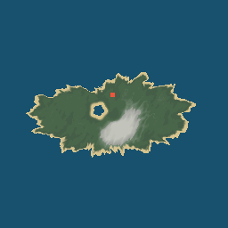
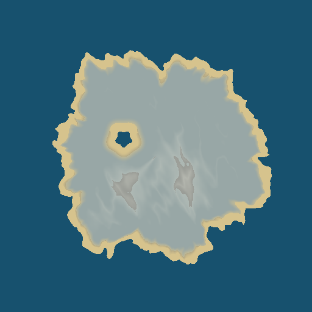
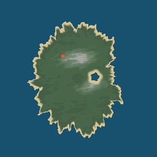
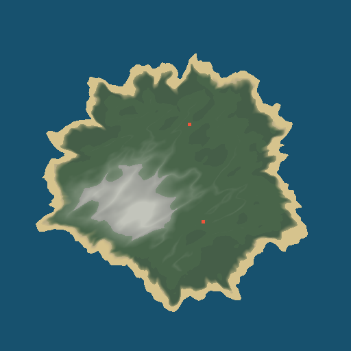
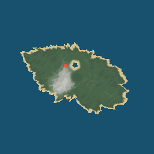
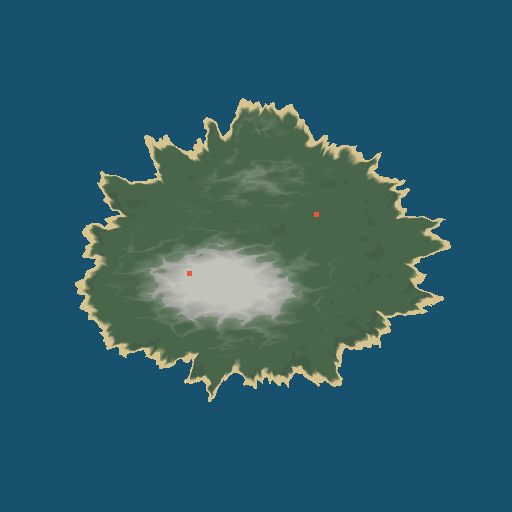

# Coastal landmarks checkpoint

Version 2 worlds created after this change plan natural coastal landmarks with a dedicated seed stream. The starting island has a sheltered bay, the first outer island has a rocky headland aligned with one of its highlands, and other islands may receive either type. The bay pulls the shoreline inward; the headland pushes it outward and raises a short coastal cliff. Terrain mesh, collision, biome sampling, caves and resource placement all use the resulting geography.

The `generation_config.coastal_landmarks_enabled` save field records whether a world uses the new coastline. New worlds set it to `true`. Existing version 2 saves without the field load with it set to `false`, preserving their previous geography for the same seed; version 1 continues through its original generator. The smoke tests check both fingerprints and a save round trip.

The following top-down maps were generated by `tools/render_world_generation_maps.gd`. They visualize sampled terrain colors and heights, not an in-game 3D camera view. The red square marks a cave mouth.

| Seed | Starting island and bay | First outer island and headland |
| --- | --- | --- |
| 12345 |  |  |
| 67890 |  |  |
| 424242 |  |  |

Three fresh Godot 4.3 headless processes measured seed `12345` with async generation after this change: initial load was 819, 825 and 827 ms, versus 795, 795 and 794 ms at the preceding collision checkpoint. The largest observed process-frame intervals were 30.0, 29.8 and 29.8 ms; the preceding checkpoint measured 29.9, 29.9 and 29.3 ms. The added geography increases worker sampling time without materially changing the measured main-thread spike. Graphical appearance, navigation across the new coastline, FPS and draw calls remain for final validation.
