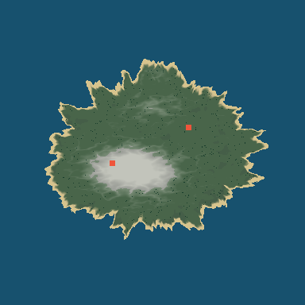
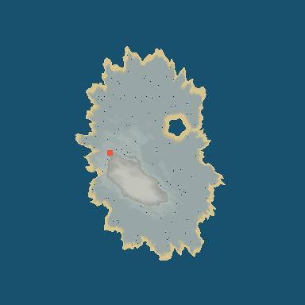
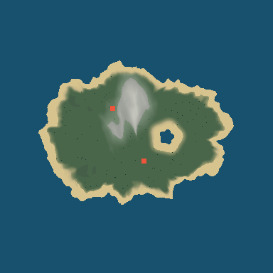
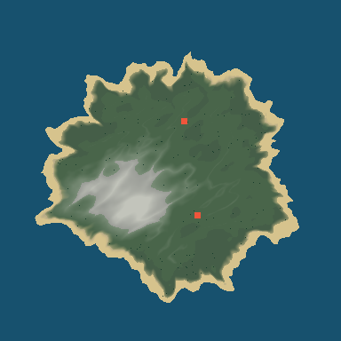
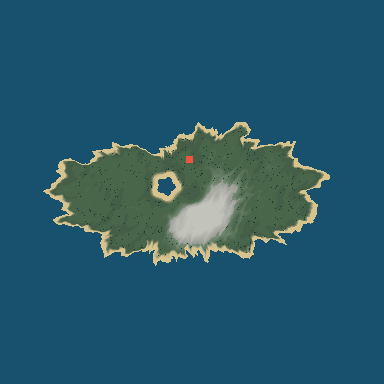

# Validação final da geração procedural v2

Executada em Godot 4.3, Linux, modo headless. Este documento registra a prioridade 7 do escopo original com resultados observados; o texto de referência permanece no anexo da tarefa, fora do repositório.

## A. Diagnóstico

Na versão 1, a seed influenciava detalhes, mas a ilha inicial tinha raio fixo de 480, as demais formavam um anel quase regular e os biomas principais seguiam o índice da ilha. Isso fazia seeds diferentes parecerem estruturalmente parecidas. A criação de mundos também convertia a entrada com `int(texto)`, sem uma conversão estável para seeds textuais. Não era um defeito único do gerador aleatório: faltavam variações geográficas em escala de arquipélago e uma política explícita de seed.

## B. Correções

`WorldSeed.parse` trata números assinados e texto UTF-8 de forma estável; streams independentes separam layout, clima, relevo, cavernas, decoração e recursos. A entrada original da seed é salva. Saves mantêm a versão do gerador: mundos v1 continuam no caminho antigo e saves v2 anteriores aos marcos costeiros preservam a costa anterior.

## C. Melhorias geográficas

A versão 2 combina costa elíptica deformada, domain warp, campos de ruído com seed, cristas, vales, planaltos locais e baías/promontórios costeiros. A altura, a cor do terreno, o bioma, as cavernas e a colocação de objetos consultam a mesma geografia.

## D. Ilhas

O arquipélago escolhe quantidade e disposição por seed, com separação mínima entre ilhas e formatos variados. A ilha inicial reserva terreno e recursos próximos do spawn. Baías e promontórios são planejados por um stream próprio, para não alterar os demais sistemas ao variar esse detalhe.

## E. Montanhas

Cristas orientadas, campos de relevo e elevações locais formam picos e encostas. Vales recortam o relevo; o promontório pode formar um penhasco curto na costa. Na amostragem de 19 × 19 pontos, a ilha central da seed `99999` alcançou 142,5 unidades de altura; a primeira ilha externa de `424242`, 179,1.

## F. Biomas

Temperatura, umidade, altitude, declive e distância da costa determinam praia, costa rochosa, floresta, campo, pântano, região árida, tundra ou área alpina. Um teste com 20 seeds encontrou 18 padrões de biomas nas amostras centrais, além de 6 quantidades de ilhas, 12 faixas de relevo e 9 classes de formato costeiro.

## G. Vegetação

Árvores decorativas, cobertura rasteira e pedras são instanciadas em grupos `MultiMesh`, com densidade guiada por bioma, clareiras e clusters. Recursos coletáveis são nós separados, com IDs persistentes. Na primeira ilha externa de `424242`, o plano gerou 454 copas decorativas; a ilha central de `0` gerou 74, demonstrando variação de densidade.

## H. Cavernas

Entradas removem triângulos da superfície; túneis têm piso, teto, câmara, fundo fechado e colisão trimesh. A validação física verificou três trechos internos com piso e espaço vertical livre em cada uma das seeds `12345`, `67890` e `424242`. O teste de malha também verifica a abertura da entrada.

## I. Desempenho

Medições em três processos novos por modo, seed `12345`, uma ilha inicial. A versão 2 usa amostragem em worker, montagem de colisão em quatro frames, cache limitado a duas ilhas, carregamento progressivo, LOD e perfis de qualidade para decoração.

| Modo | Carga inicial (ms) | Maior intervalo entre frames (ms) | Reentrada pelo cache (ms) | Aumento de memória estática do processo |
| --- | --- | --- | --- | --- |
| v1 síncrono | 318, 316, 317 | 317,6; 315,6; 316,9 | 286, 283, 284 | 20,41 MiB |
| v2 assíncrono | 815, 815, 823 | 29,4; 28,9; 29,2 | 28, 29, 29 | 13,66 MiB |

A ilha central v2 tinha 34.462 triângulos, 383 copas, 488 instâncias rasteiras e 45 pedras decorativas. A primeira ilha externa de `12345` carregou em 378, 381 e 378 ms, com maior intervalo de 24,7 ms e 50 copas. Os valores de memória são do processo inteiro, não o custo isolado das ilhas. O carregamento inicial v2 leva mais tempo total que v1; o ganho medido é sobretudo a redução do bloqueio de um único frame e a reentrada pelo cache. O pico v2 ainda supera 16,7 ms.

## J. Seeds testadas

Os testes de diversidade percorreram 20 seeds, incluindo `0`, `1`, `12345`, `67890`, `99999`, negativas e textuais. O [auditor](../../tools/audit_world_generation.gd) gerou assinaturas completas em dois processos independentes para `0`, `1`, `12345`, `67890`, `99999`, `-42`, `ilha tropical` e `424242`: as oito repetiram exatamente a assinatura de layout, alturas, biomas, cavernas, decoração e recursos. Seeds diferentes produziram assinaturas e características geográficas diferentes.

Na validação física, `12345`, `67890` e `424242` tiveram respectivamente 13, 21 e 15 direções amostradas com praias e colisão acessíveis; 47, 44 e 41 recursos ficaram sobre o terreno, fora das aberturas de caverna.

## K. Arquivos principais

- `scripts/world/world_seed.gd`: conversão e derivação estável de seeds.
- `scripts/world/island_generator_v2.gd` e `island_generation_job.gd`: geografia, biomas, cavernas, recursos, streaming, cache e geração assíncrona.
- `scripts/core/main.gd`, `save_manager.gd` e `scripts/ui/main_menu.gd`: configuração, entrada e persistência da seed e versão do mundo.
- `tests/smoke_v2_final_navigation.gd`: colisão real de spawn, praias, recursos e cavernas em três seeds.
- `tools/audit_world_generation.gd`, `benchmark_world_generation.gd`, `benchmark_outer_chunk.gd` e `render_final_validation_maps.gd`: reprodução das verificações.

## L. Limitações

O ambiente só oferece o renderer headless. As imagens abaixo são mapas diagnósticos amostrados; não validam iluminação, materiais, FPS médio, draw calls ou a aparência durante o jogo. O teste de modelos importados exige explicitamente renderer gráfico. Quatro testes antigos de fluxo de save/menu aguardam `RenderingServer.frame_post_draw`, evento que não ocorre neste modo, e atingiram o limite de 18 segundos. Esses fluxos e a navegação com controle real do jogador ainda precisam ser verificados numa execução gráfica. A diferença de contato nas bordas das quatro peças de colisão também merece teste manual.

Lagos são representados por depressões no relevo, mas rios, cachoeiras e simulação hidráulica completa não foram implementados; a seção de água doce do escopo os condiciona à viabilidade técnica. Não há animação de vento ou neblina específica por bioma. A reentrada no cache ainda calcula posições de recursos sincronamente. O pico observado de ~29 ms e a carga inicial de ~0,8 s continuam acima de uma meta de frame contínuo a 60 FPS.

## M. Validação executada

- 34 dos 39 smoke tests do repositório passaram em headless. Os outros cinco têm as limitações descritas acima; não foram contados como aprovados.
- `smoke_v2_final_navigation.gd` passou nas três seeds; `smoke_v2_seed_diversity.gd` passou nas 20 seeds.
- Assinaturas de oito entradas de seed coincidiram em duas execuções novas cada. Os fingerprints congelados de geografia e recursos também passaram.
- Benchmarks central e externo foram repetidos três vezes por modo; as cinco imagens abaixo foram geradas e inspecionadas.

### Comparação visual dos mapas

As cores representam altura/bioma amostrados; pontos verde escuro são centros de copas geradas e quadrados vermelhos são entradas de caverna. O [renderizador](../../tools/render_final_validation_maps.gd) reproduz as imagens.

| Caso | Evidência | Mapa |
| --- | --- | --- |
| Floresta densa | Seed `424242`, ilha externa 1, 454 copas |  |
| Montanha | Seed `99999`, ilha central, altura amostrada 142,5 |  |
| Praias extensas | Seed textual `ilha tropical`, ilha externa 1, 29 pontos de praia na grade |  |
| Região com cavernas | Seed `67890`, ilha externa 1, duas entradas |  |
| Composição distinta | Seed `12345`, ilha inicial com baía abrigada |  |
